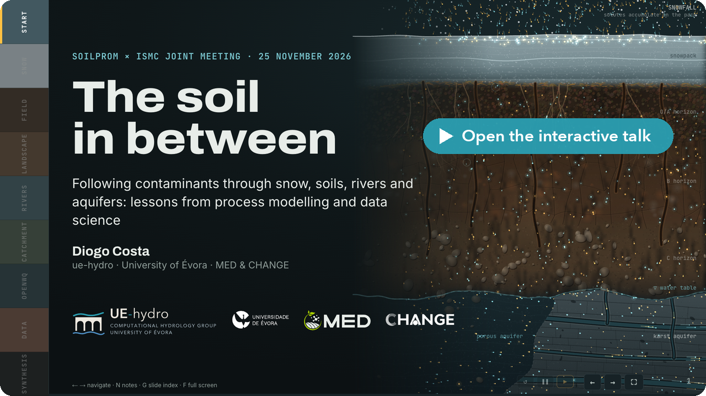

  <picture>
    <source media="(prefers-color-scheme: dark)" srcset="assets/ue-hydro_logo_dark.svg">
    
  </picture>

  Department of Geosciences · University of Évora · MED &amp; CHANGE 
  <a href="https://ue-hydro.uevora.pt">Website</a> ·
  <a href="https://openwq.readthedocs.io">OpenWQ docs</a>

---

### What we do

We study how water, and what it carries, moves through landscapes: from snowpacks and soils to rivers, aquifers, lakes and floodplains. Our focus is water quality (nutrients, oxygen, pH, sediments and contaminants) and the processes that store, delay and transform solutes on their way to rivers.

We build open-source, process-based models and couple them to the main hydrological frameworks, so that the same chemistry can run with different hydrology. We combine them with monitoring data, field and laboratory work, large-sample calibration on high-performance computers, and hybrid physics–machine-learning approaches. Applications range from single fields and urban floods to river basins, continental benchmarks and global water-quality modelling, including operational flood forecasting.

### Some key models

| Repository | What it does |
|---|---|
| [**openwq**](https://github.com/ue-hydro/openwq) | OpenWQ: multi-chemistry, multi-scale water-quality modelling framework (biogeochemistry, sediments, PHREEQC geochemistry) coupled to host hydrological models |
| [**FLUXOS_cpp**](https://github.com/ue-hydro/FLUXOS_cpp) | FLUXOS: 2D shallow-water hydrodynamics with solute transport; regular and triangular meshes, OpenMP, MPI and GPU |
| [**PULSE_cpp**](https://github.com/ue-hydro/PULSE_cpp) · [**PULSE**](https://github.com/ue-hydro/PULSE) | Snowpack chemistry and the ionic pulse during snowmelt |
| [**bur_pc_floodcast**](https://github.com/ue-hydro/bur_pc_floodcast) | Operational flood forecasting for Alcácer do Sal |

### Some key OpenWQ couplings

| Repository | Host model |
|---|---|
| [summa-mizuroute-openwq](https://github.com/ue-hydro/summa-mizuroute-openwq) | SUMMA with internal mizuRoute routing |
| [Summa-openWQ](https://github.com/ue-hydro/Summa-openWQ) | SUMMA land surface and hydrology |
| [mizuRoute-OpenWQ](https://github.com/ue-hydro/mizuRoute-OpenWQ) | mizuRoute river routing |
| [lisflood-code](https://github.com/ue-hydro/lisflood-code) | LISFLOOD (Copernicus GloFAS), global water quality |
| [hydroDL2-openwq](https://github.com/ue-hydro/hydroDL2-openwq) | Differentiable hydrological models (hybrid physics–ML) |

### Talks

<table>
  <tr>
    <td>
      
       
      <b><a href="https://ue-hydro.github.io/the-soil-in-between/">The soil in between</a></b>: following contaminants through snow, soils, rivers and aquifers; lessons from process modelling and data science. 
      SOILPROM × ISMC joint meeting, 25 November 2026 · interactive HTML slides (arrow keys to navigate)
    </td>
  </tr>
</table>
